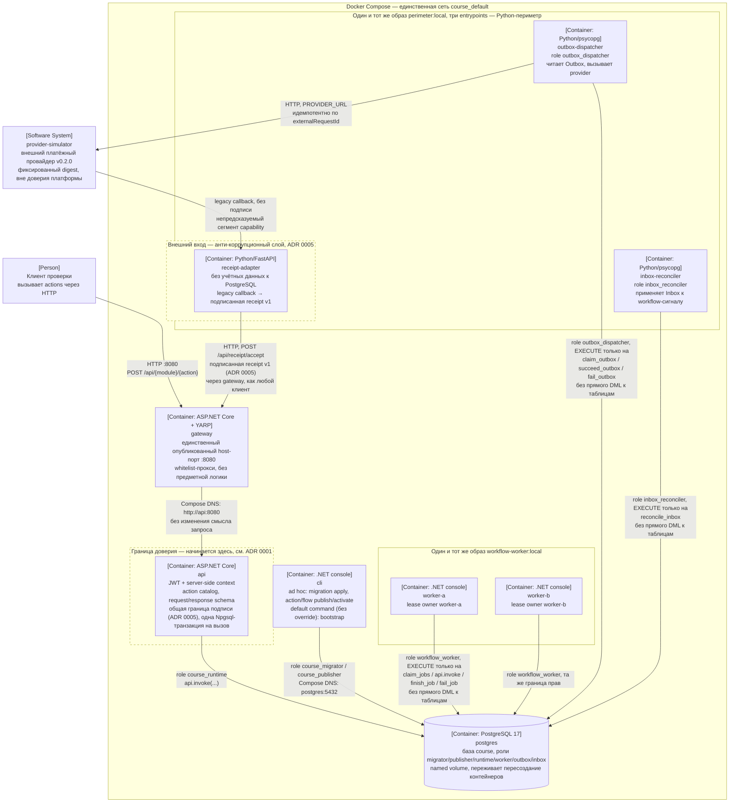

# C4 Container

Диаграмма — обычный mermaid `flowchart` с подписями в C4-нотации
(`[Container: ...]`, `[Person: ...]`, `[Software System: ...]`), без
`C4Container`: этот диалект mermaid экспериментальный и на GitHub рендерится
нестабильно. Здесь важна воспроизводимость ссылки у куратора, а не точное
соответствие спецификации C4.

## Что показано

- **Клиент** обращается только к `gateway` по `http://localhost:8080` —
  единственному опубликованному host-порту во всём Compose-файле.
- **`gateway`** проксирует whitelisted-маршруты (`/api/*`, `/openapi/*`,
  `/health/*`) на `api` по Compose DNS (`http://api:8080`), а не через
  `localhost` — DNS-имя сервиса разрешается только внутри сети Compose.
- **`api`** — единственный сервис, у которого есть роль `course_runtime` и
  который вызывает `api.invoke(...)`; граница доверия (ADR 0001) проходит
  по входу в `api`, а не по `gateway`.
- **`cli`** использует роли `course_migrator` и `course_publisher` — не
  `course_runtime`, и не участвует в обслуживании клиентских HTTP-запросов.
  Ad hoc вызовы (`compose run --rm cli <args>`, так проверка и `make`-цели
  запускают `migration apply`/`action publish`/`flow ...`) переопределяют
  его command; без override при `docker compose up` он выполняет свой
  command по умолчанию, `bootstrap`, — применяет миграции и публикует
  встроенные actions, затем завершается.
- `api` не имеет `depends_on` на `cli`: неделя 2 требует ровно шесть
  сервисов (`gateway`, `api`, `cli`, `postgres`, `worker-a`, `worker-b`), и
  открытая проверка строит/поднимает только их, по имени — седьмого
  `bootstrap`-сервиса, блокирующего старт `api`, в этом списке нет.
  `/health/ready` у `api` не ждёт миграций, только соединение с PostgreSQL.
- **`worker-a`** и **`worker-b`** — два экземпляра одного и того же образа
  `workflow-worker:local`, различаются только `WORKFLOW_WORKER_OWNER`. Ни
  один не публикует порт и не обращается к `api`/`gateway` по сети: каждый
  напрямую подключается к `postgres` ролью `workflow_worker`, у которой есть
  `EXECUTE` ровно на четырёх функциях (`claim_jobs`, `api.invoke`,
  `finish_job`, `fail_job`) и нет прямого DML ни к предметным, ни к
  workflow-таблицам — та же граница доверия, что и у `api` (ADR 0001), но
  для другого principal и без HTTP-входа вовсе. Миграция 025 по пути также
  выдавала `EXECUTE` на `api.get_action_manifest` — миграция 027 его
  отозвала, когда C#-исполнитель перестал перечитывать manifest на
  воркер-вызовах (`claim_jobs` уже отдаёт все нужные поля сам), так что
  финальная граница — ровно эти четыре, как и называет TASK.md.
- **`postgres`** хранит данные в named volume, переживает удаление и
  пересоздание `gateway`, `api` и обоих воркеров.
- **`outbox-dispatcher`**, **`receipt-adapter`**, **`inbox-reconciler`** — три
  entrypoints одного и того же локально собранного образа `perimeter:local`
  (`python/Dockerfile`), Python-периметр между ядром и `provider-simulator`.
  Периметр — транспорт и трансляция: он не выбирает карту, не считает лимит,
  не назначает переход и не ставит финальный статус ([ADR 0006](../adr/0006-outbox-inbox-state-stays-in-postgres.md)).
  `outbox-dispatcher` и `inbox-reconciler` подключаются к `postgres` напрямую
  ролями `outbox_dispatcher`/`inbox_reconciler`, у каждой `EXECUTE` только на
  свои функции схемы `delivery` и нет прямого DML ни к одной таблице —
  граница выражена привилегией, не соглашением (ADR 0006). `receipt-adapter`
  не имеет учётных данных к PostgreSQL вовсе: он получает legacy callback от
  `provider-simulator` по пути с непредсказуемым сегментом `capability`,
  переводит его в подписанную receipt v1 (анти-коррупционный слой, ADR 0005)
  и отправляет `POST /api/receipt/accept` через `gateway`, как любой другой
  клиент платформы — без обхода границы доверия ADR 0001.
- **`provider-simulator`** — внешний платёжный провайдер v0.2.0, образ по
  закреплённому digest, вне доверия платформы. Получает запрос на списание от
  `outbox-dispatcher` и асинхронно шлёт legacy callback на `receipt-adapter`;
  ни один из четырёх периметровых сервисов не публикует host-порт.
