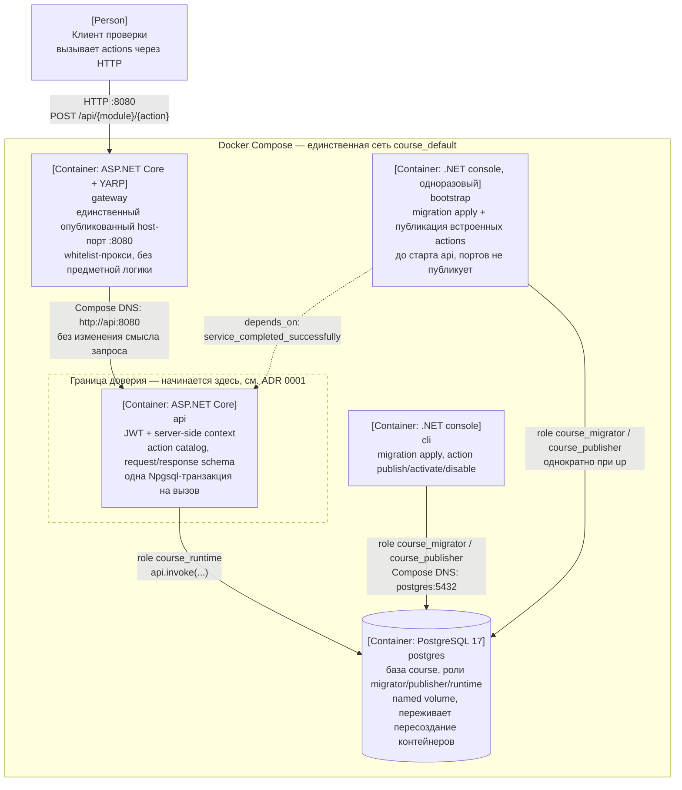

# C4 Container

Диаграмма — обычный mermaid `flowchart` с подписями в C4-нотации
(`[Container: ...]`, `[Person: ...]`, `[Software System: ...]`), без
`C4Container`: этот диалект mermaid экспериментальный и на GitHub рендерится
нестабильно. Здесь важна воспроизводимость ссылки у куратора, а не точное
соответствие спецификации C4.

## Что показано

- **Клиент** обращается только к `gateway` по `http://localhost:8080` —
  единственному опубликованному host-порту во всём Compose-файле.
- **`gateway`** проксирует whitelisted-маршруты (`/api/*`, `/openapi/*`,
  `/health/*`) на `api` по Compose DNS (`http://api:8080`), а не через
  `localhost` — DNS-имя сервиса разрешается только внутри сети Compose.
- **`api`** — единственный сервис, у которого есть роль `course_runtime` и
  который вызывает `api.invoke(...)`; граница доверия (ADR 0001) проходит
  по входу в `api`, а не по `gateway`.
- **`cli`** и **`bootstrap`** используют роли `course_migrator` и
  `course_publisher` — им не нужен `course_runtime`, и они не участвуют в
  обслуживании клиентских HTTP-запросов.
- **`bootstrap`** запускается один раз, применяет миграции и публикует
  встроенные actions, затем завершается; `api` стартует только после его
  успешного завершения (`depends_on: service_completed_successfully`) и не
  публикует host-порт.
- **`postgres`** хранит данные в named volume, переживает удаление и
  пересоздание `gateway` и `api`.
